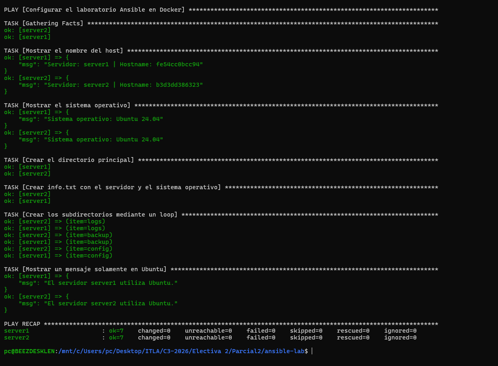

# Laboratorio de Ansible con Docker

## Objetivo de la práctica

Automatizar la configuración de dos servidores Ubuntu 24.04 con Ansible: mostrar el nombre del host y el sistema operativo, crear `/tmp/ansible-demo/info.txt` con los datos de cada servidor, generar los directorios `logs`, `backup` y `config` mediante un loop, y mostrar un mensaje únicamente cuando el sistema operativo sea Ubuntu.

## Comandos para iniciar los contenedores

Desde la raíz del repositorio:

```bash
cd ansible-lab
docker compose up -d
```

## Comando para ejecutar el playbook

Desde la carpeta `ansible-lab`:

```bash
ansible-playbook -i inventory.ini playbook.yml
```

## Captura de la ejecución exitosa del playbook


